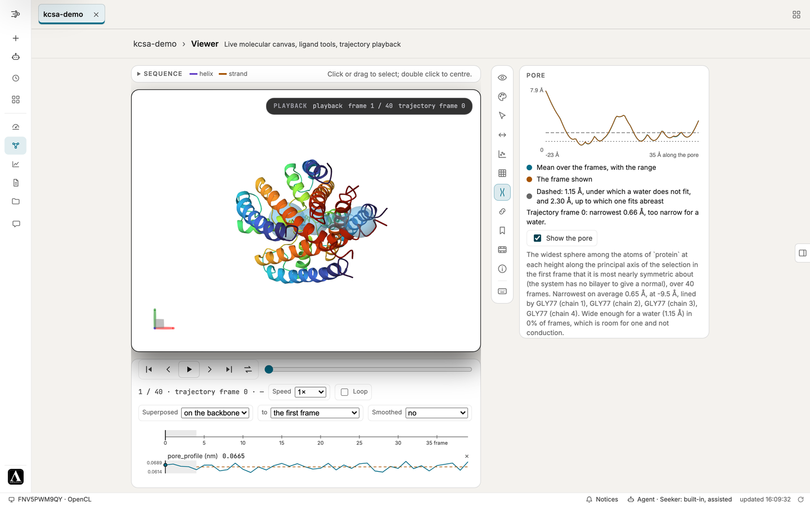

# The FastMDXplora analyses

Twenty-eight analyses of the trajectory, and three more that read what a biased
run itself produced.

Each writes its data, its figure, and the settings it actually used:

```
analysis/<name>/
├── <name>.dat            the numbers
├── <name>.png            the figure, at figure_width (the page unless set)
├── <name>_greyscale.png  only with figure_colours: both
└── options.json          selection, every option, findings, and the .dat format
```

Choose them in a [Config](config.md):

```yaml
analysis:
  include: [rmsd, rmsf, rg, ss]        # or exclude: [sasa, dimred]
  scope: solute
  options:
    cluster: {methods: [kmeans], n_clusters: 8}
```

---

## The catalogue

### Shape and size

| | |
|---|---|
| `rmsd` | How far the structure has moved from a reference frame |
| `rg` | Radius of gyration — how compact it is |
| `sasa` | Solvent-accessible surface area: total and its hydrophobic and polar parts, per residue, or each residue's mean and relative SASA |
| `ss` | Secondary structure per residue per frame, by DSSP |

### Flexibility

| | |
|---|---|
| `rmsf` | Per-atom or per-residue fluctuation about the mean |
| `order_parameters` | Backbone N–H order parameters, the quantity NMR relaxation measures experimentally |
| `bfactor_comparison` | Per-residue fluctuation against the deposited structure's B-factors |
| `thermodynamics` | Density, energies and temperature, from the state record the run wrote |
| `rdf` | The radial distribution between two selections, stopped at half the box |
| `coordination_number` | How many of one selection sit within a shell of the other |
| `dihedrals` | Backbone phi, psi and omega, with the Ramachandran plot |

`coordination_number`'s cutoff is asked for, or read from this run's own first
minimum in g(r) — never assumed, because the radius decides the number.

### Geometry

| | |
|---|---|
| `pair_distance` | The separation of two selections, by centre of mass or closest approach, by the minimum image in a periodic cell of any shape |
| `end_to_end` | The distance between the two ends of a chain, the coarsest description of extension there is |
| `moments_of_inertia` | The three principal moments, which separate a rod from a disc where the radius of gyration cannot, and the asphericity, acylindricity and relative shape anisotropy of the gyration tensor |
| `image_check` | The solute's closest approach to its own periodic images in every frame, with the frames within the cutoff counted |

`image_check` runs first on every study with a solute in a periodic box,
a study that lists its analyses (`include`) too, unless excluded by name
(`exclude: [image_check]`, said in the log, the analysis manifest and the
report: the solute is then not checked, and no mean says whether it met its
copy, except the end-to-end distance, which checks its own chain against the
run's cutoff and says it as its own check, there being no Image check section
to point to). It does the check as
`gmx mindist -pi` does the check: in each frame, made whole along its bonds,
the closest approach of any heavy atom of the solute to any heavy atom of its
images, every image the
solute could reach searched (the shifts enumerated from the closest approach
plus the solute's diameter, however many cells that is), in a cell of any
shape, found with a k-d tree; kept as a series
(`image_check.dat`), with the frames under the cutoff and under 0.5 nm
counted, and the closest
approach with its frame, its time and its two atoms (`findings.solute_image`).
The solute is the macromolecules: every protein and nucleic
acid residue and every other polymer chain (a molecule bonded across two or
more residues; in a topology with no bonds, a chain of two or more residues),
so an RNA, a DNA duplex or a peptide of non-standard residues is checked as a
protein is; a ligand or cofactor is counted with them only where it is in the
solute the analyses already use (the scope's, `protein or resname LIG` with a
ligand); water, ions and lipids never. Its molecules are grouped into
complexes in the first frame the check reads: molecules bonded to each other,
or in contact (any heavy atoms within 0.5 nm, at the nearest image), are one
complex, kept whole from frame to frame. The grouping is not made again as the
run goes: a complex that parts, a ligand that unbinds, or molecules that join
during the run are grouped as in the first frame read, so a parted dimer may
be noted and an oligomer formed later is checked as its molecules. Each
complex is checked against its own periodic images only. A copy meeting another copy's image (eight
peptides in a box, an aggregation study) is contact between molecules in the
box, their concentration, not a self-image, and is not counted: eight 2.2 nm
peptides on a grid in a 6 nm cube each come 3.80 nm from their own images,
though taken together they came 0.80 nm from theirs. The finding says how
they were grouped (`complexes`, `grouped`). Heavy atoms only, where
`gmx mindist -pi` counts every atom, so the distance reads about 0.1 nm longer
than the closest pair of atoms that interact.
The cutoff is the run's own real-space cutoff: its `nonbonded_cutoff_nm` as
set or as setup resolved it, read from the setup record of the system the run
simulated, found as the report and the GUI find it (the study's own
`setup/setup_parameters.json`, or the one its `setup_from` names, an umbrella
window's shared setup among them); else the cutoff of the force field that
record names (1.2 nm for CHARMM36, 1.0 nm for AMBER); else 1.0 nm, taken, and
why. The finding says which and from where ("The cutoff is 1.2 nm, read from
the run's `nonbonded_cutoff_nm` as setup resolved it, in ...", `cutoff_from`),
and `cutoff_nm` under `options: {image_check: ...}` sets another.
Where the solute comes within the cutoff of its image, it is interacting with
its own copy in those frames. That may bias a mean over them; it does not
make the mean's statistical error unknown. So every mean keeps its error bar,
and every analysis of those frames carries a note, counted over the frames it
uses (after its mean's discarded equilibration, or from its `start` as its
record of the frames read says it; for an analysis without a main mean, the
moments' or the secondary structure's, over the frames its means use, said as
the union where they differ; for the thermodynamics, over the energy rows
each mean averages, on the energy record's own interval, each read at the
trajectory frame nearest its time), once in
its `findings.solute_image` ("The solute came within 1 nm of its own periodic
image in 105 of 280 frames used (38%); the closest, 0.580 nm at frame 299,
2.99 ns. ..."), with its numbers on each mean record it holds (SASA's
hydrophobic and polar, the moments' shape descriptors), and on each reweighted
average of a biased run. For an analysis of the solute's shape or
conformation the note says its shape may be biased; for the thermodynamics
and the solvent's analyses, that a mean may be. The report says the check's
finding once, in its own section, and under each analysis one line pointing
there. Every page that shows the mean (the Overview's tiles and production
means, the Analysis page's table, the line over each card, its caption and its
convergence, the Report page's table, the runs of a study compared and the
Report page's table of runs, the written comparison and the slides) and the
Agent (the means cited under its answers too) say the note beside the
mean's verdict, which it does not change ("may be biased: in 54 of 270
frames used (20%) the solute was within 1 nm of its own image"), the analysis's
paragraph a click away, all read from the record by one reader
(`fastmdxplora.image_note`); an analysis with no mean over its frames (RMSF,
the order parameters, the dihedrals, clustering, the projections) says its
note on its row of the Analysis page's table and over its card, and RMSF's
caption beside its mean over residues; the image check's own row and card
give its finding in a sentence.
Frames where no mean is used (the discarded equilibration) do not count, and
an analysis whose frames never met the image carries no note. `end_to_end`
alone withholds its error for it, as it did before the whole chain was
checked (where an end came within 1.0 nm of the other end's image): it reads
the same note rather than checking the chain's two ends alone, which passed
a chignolin chain that came to 0.261 nm of its own copy. Grading the note by
how often and how close (a note only under a small share of frames never in
contact; past it, the mean over the frames clear of the image given beside
it) waits for thresholds fixed in a registered check. A larger box, in a new study, is what
changes it; setup's default padding is 2.0 nm for this reason (see
[Config reference](config_reference.md)).
Within the cutoff the solute sees its image (it interacts with its copy in
direct space); it is in contact with it only under 0.5 nm, and the finding
counts both. The report's Convergence part says how many frames were within
the cutoff and in contact; where the solute was in contact with its image in
every frame, it lists any claim about the solute's shape among what the run
cannot support, since a longer run in the same box samples the same contact,
and says that the longer run it asks for may determine the means without
lifting that bias, as the Overview's lead and the Agent's answers on run
length and on what would strengthen the run say beside the longer run they
advise (`image_note.longer_run_said`), with or without a figure of how much
longer. Where every mean is determined, the lead and those answers say that
the means may still be biased by the image and that a larger box lifts it,
never "determined" or "yes" alone, and replicas are advised in a larger box
(`image_note.determined_said`).
Not done yet: complexes are not grouped again frame by frame (above); the
check is not said while the run goes; a ligand's approach
to an image of the protein is not recorded apart from the complex's; the
note is not graded by thresholds (above); the GUI's map of time against time
plots its last block a full block wide where the figure plots it its own
width; several workers clustering at once each plan on the same memory; and
no frame cap is set by default (a cap is the person's choice); and fetching a
study from another machine does not yet give its sizes by kind.

### The bilayer

| | |
|---|---|
| `area_per_lipid` | The area a lipid occupies in the plane of the bilayer, with the protein's cross section taken out |
| `bilayer_thickness` | The distance between the two leaflets' phosphate planes, D_PP |
| `lipid_order` | The acyl-chain order parameter S_CD of every carbon, the quantity deuterium NMR measures |

The three numbers a membrane run is checked against before anything about the
protein in it is believed: each has an experimental value, and each moves when
the force field, the temperature or the barostat is wrong. They run only where
there is a bilayer. See [Membrane proteins](membranes.md) for what each
computes, and what to compare it with.

### The pore

| | |
|---|---|
| `pore_profile` | The radius of the way through a channel along its axis, as HOLE measures it, and its narrowest radius per frame |



At each height along the pore's axis, the largest sphere that fits among the
protein's van der Waals surfaces with its centre in that plane (Smart et al.,
J Mol Graph 14, 354 (1996)). The path starts at the protein's centre, or at
the centre of `start_selection`, and is followed plane by plane both ways
until the sphere reaches `end_radius_nm` (1 nm), which is bulk solvent. HOLE
searches each plane by Monte Carlo; this search tries a fixed pattern of
steps down to 0.005 nm, so the same frames always give the same profile.
Each frame's protein is first fitted onto the first frame's, so the heights
and the centre line are the protein's own however it drifts and turns in its
bilayer. The axis is z where there is a bilayer and otherwise the principal
axis the protein is most nearly symmetric about; `axis` names another.

The per-frame number is the narrowest radius, with its mean, error and
independent samples as every time series has. Beside it are the profile
(`pore_radius.dat`: mean, standard deviation, least and most at each height),
the path frame by frame (`pore_path.npz`), the residues that line the
narrowest point, and the share of frames in which that point is at least
0.115 nm wide, below which a water does not fit. Room for a water is not
conduction: a hydrophobic gate can be wide enough and dry.

Three things to know before believing one:

- **It does not know whether the protein is a channel.** Through a protein
  with no pore the path squeezes between helices and reports a radius near
  zero. So it never runs by default; name it in `include`.
- **A pore in each subunit needs its start named.** The protein's centre is
  in the pore of a channel whose subunits surround it, and between the pores
  of one, such as an aquaporin, with a pore in each subunit: give
  `start_selection` one subunit or the residues lining its pore.
- **A path can leave through a gap in the wall**, as HOLE's can. The profile
  then ends early; `findings.pore` says over which heights it was followed.

It is held against tubes of known radius and against KcsA (1BL8), whose
selectivity filter it finds closed to water at Gly77 with the cavity beside
it about 0.45 nm in radius. It has not been compared with HOLE itself, frame
for frame.

### Slow processes

| | |
|---|---|
| `markov_model` | A Markov state model of the frames: tICA, k-means microstates, a reversible transition matrix, and the implied timescales of the slowest processes across lags |

The frames are described by alpha-carbon distances or backbone torsions
(`features`), projected by tICA and scaled by the kinetic map, and cut into
`states` (100) microstates by k-means. The transition matrix is estimated by
maximum likelihood under detailed balance on the largest set of microstates
that reach each other, at every lag from one frame to a fifth of the run, and
the model is built at the shortest lag at which the slowest timescale has
levelled off.

- **Where the timescales never level off**, the model is said not to be
  Markovian at any lag tried, and its timescales are lower bounds.
- **A process crossed fewer than ten times**, or slower than a third of the
  run, is said to be unresolved: its timescale is a lower bound.
- **Not built:** metastable sets (PCCA+), Chapman-Kolmogorov tests, Bayesian
  errors. deeptime and PyEMMA do these.

Held against a hidden Markov chain of known transition matrix, whose
timescales it recovers within 15%; not compared with deeptime on one
trajectory.

### Against experiment

| | |
|---|---|
| `nmr_observables` | 3J(HN,HA) couplings from each residue's phi and NOE distances, averaged as the experiment averages them, beside the measured values where given |

Couplings come from a Karplus equation (Vögeli et al., 2007, unless
`karplus` names MDTraj's `Bax1997` or `Ruterjans1999`), averaged over the
frames; NOE distances are `<sum r^-6>^(-1/6)`, summed over the atoms each
side names. With `j_couplings_file` (`residue`, `j_hz`, and `chain` where
there are several) the RMS difference is given beside the Karplus set's own
scatter (0.39 Hz for Bax2007), the least difference that says anything; with
`noe_file` (`selection_1`, `selection_2`, `upper_nm`) each pair's violation
is given.

- **Not computed:** a SAXS curve, which needs the hydration shell modelled
  (CRYSOL, Pepsi-SAXS), and chemical shifts, which need a trained predictor
  (SPARTA+, SHIFTX2).

Held against MDTraj's own couplings and against NOEs of known averages.

### Double helices

| | |
|---|---|
| `nucleic_acid` | A DNA or RNA duplex's base-pair parameters (shear, stretch, stagger, buckle, propeller, opening) and step parameters (shift, slide, rise, tilt, roll, twist), frame by frame |

Each base is given the standard reference frame of Olson et al. (2001),
fitted to its ring atoms, and the parameters come from the frames by 3DNA's
own construction (CEHS), in nm and degrees. Watson-Crick pairs are found in
the first frame and followed; one whose N1 and N3 come over 0.4 nm apart in
more than a fifth of the frames is said to.

- **Not computed:** groove widths, the helical axis and its bending, sugar
  puckers and backbone torsions (3DNA, Curves+, cpptraj's `nastruct`).

On the Dickerson dodecamer (1BNA) it gives rise 0.336 nm, twist 35.6
degrees and propeller -12 degrees on average, with the AATT core's propeller
near -17; building a helix from given parameters and measuring it gives them
back. It has not been compared with 3DNA's output for one structure.

### Helices

| | |
|---|---|
| `helix_geometry` | Each helix's tilt from the bilayer's normal (or a named axis) and its kink, frame by frame |

The helices are the runs of DSSP's H of eight residues or more in the first
frame, or the residue ranges named in `helices`. Each helix's axis is found
from its alpha carbons by Kahn's local axes, as HELANAL finds it: the tilt is
the angle from the reference, 0 to 90 degrees; the kink is the angle between
the mean local axis of its first half and of its second, a few degrees for a
straight helix and twenty or more at a proline kink.

- **A tilt needs something to be tilted from.** That is z, the normal, where
  there is a bilayer, or the axis named in `reference_axis`. Without either,
  only the kink is given.
- **A helix that unwinds is still followed** as the same residues, and the
  share of frames in which DSSP still finds it helical is recorded beside it.

Held against ideal helices built at known tilts and kinks, and against KcsA
(1BL8), whose outer and inner helices it finds 23 and 36 degrees from the
channel's axis; not compared with HELANAL itself.

### Solvation

| | |
|---|---|
| `gist` | Which waters about a site would be costly to displace: each cube's water density, energy and entropy against bulk water (grid inhomogeneous solvation theory) |

Space about the ligand (or `center_selection`) is cut into cubes `voxel_nm`
wide, the protein fitted to its first frame. For each, from the waters found
there: the density over bulk, each water's energy with the solute and half
its energy with other water less bulk water's (from the study's own force
field, Coulomb and Lennard-Jones by the minimum image to `cutoff_nm`), and the
first-order translational and orientational entropies. Summed over a region,
`dA = dE_sw + dE_ww - TdS` is what the water there costs a ligand that
displaces it. Maps of density and free energy are written as OpenDX.

- **Every water has to be stored** (`simulation.save_selection: all`).
- **Long-range electrostatics are cut off**, with no Ewald correction, as
  cpptraj's GIST does by default.
- **Orientational entropy needs waters**: a cube that held fewer than
  `min_waters` over the run is left at zero, and counted.
- **First-order entropies** leave out waters' joint ordering, and overstate
  the loss, as GIST generally does.

Its orientational entropy matches the analytic value for Gaussian spreads
and is zero for random orientations; its energies match OpenMM's; for a
sodium ion in TIP3P it finds the first shell dense, held and ordered, and
bulk water at TIP3P's density. **It has not been compared with cpptraj's GIST
on one trajectory**; that is to be done on aailab01.

### Motion

| | |
|---|---|
| `diffusion` | The mean squared displacement of the selection's molecules against the lag, and the diffusion coefficient its slope gives |

Each molecule of the selection (water unless another is named) is followed by
its centre of mass, and its mean squared displacement is averaged over the
molecules and over every pair of frames the same lag apart. The coefficient is
the slope between a tenth and a half of the run (`fit_from`, `fit_to`) over
2d, d the dimensions, in nm²/ns, which is 1e-5 cm²/s.

- **The paths are put back together.** A molecule that crosses a face of the
  cell is stored on the other side. Each step between consecutive frames is
  taken to its nearest periodic image in the later frame's cell and the steps
  summed (von Bülow, Bullerjahn and Hummer, 2020), which stays right under a
  barostat. Frames saved so far apart that a molecule moves over a fifth of
  the cell between two of them are refused: a step past half the cell is
  stored as a shorter one the other way, and the coefficient would be too
  small with nothing to show for it.
- **Motion is measured against the centre of mass of every atom stored**,
  since the frames follow the solute. For the lipids of a bilayer it is
  measured in the plane of the bilayer against each leaflet's own centre
  (`plane`, `relative_to`).
- **The exponent says whether it is diffusion.** `findings.diffusion.exponent`
  is how the displacement grows with the lag over the lags fitted: 1 is
  diffusion, and below 0.8 the result says the molecules are still caged or
  confined and the slope is not a coefficient.
- **The cell's size is not corrected for.** A periodic cell lowers the
  coefficient by 2.837 kT / (6πηL) (Yeh and Hummer, 2004), about a tenth for
  water in a 4 nm cell; that needs the viscosity, which is not in the frames.
- **A lone solute cannot be followed in frames that hold nothing else.**
  The frames are centred on it; with the solvent stored
  (`simulation.save_selection: all`) its motion against the whole is
  recovered, and without it the analysis refuses.

The error is the standard error across five groups of molecules, withheld
for fewer than 25. It is held against random walks of a known coefficient,
in a fixed cell, a cell that breathes and frames that drift; it has not been
compared with `gmx msd` on one trajectory.

| | |
|---|---|
| `cross_correlation` | Which residues move together: the dynamic cross-correlation map of the alpha carbons, from -1 (always opposite) to 1 (always alike) |

Each frame is fitted to the mean structure (on the selection, or on
`fit_selection` to see the rest move against one domain), and every pair's
displacements are correlated (Ichiye and Karplus, 1991). Two domains closing
on a hinge show as two blocks, positive within and negative between. The map
is in `cross_correlation.npz`, and the 100 strongest pairs each way, less
neighbours fewer than `min_separation` (4) residues apart, in
`cross_correlation.dat`.

- **It sees motion along one line only.** Two parts moving in concert at
  right angles correlate to zero, so zero does not mean independent.
- **The map is a property of the fit.** Fitted on the whole, a small mobile
  part is read against the frame the rigid part sets.
- **It needs sampling.** The map is made again from each half of the run;
  where the two agree to less than 0.5 the result says the run has not
  sampled the motions it shows.

Held against motions whose correlations are known by construction; not
compared with Bio3D or cpptraj on one trajectory.

| | |
|---|---|
| `residue_network` | The residue interaction network: which residues are its bottlenecks, and the shortest path between two named sites |

Each residue is a node; two are joined where their heavy atoms are within
0.45 nm in at least 75% of the frames (`contact_cutoff_nm`,
`contact_share`), neighbours along a chain left out, and each join is as
long as -log|C| of their alpha carbons' cross-correlation, so residues that
move together are close (Sethi et al., 2009, the method of VMD's
NetworkView). Each residue's betweenness, the share of shortest paths
running through it, is in `residue_network.dat`; with `source` and `sink`
named, the shortest path between them is in the findings.

- **A path is not a signal.** It runs where residues in lasting contact move
  together; that communication travels along it is not shown.
- It carries the cross-correlation's blindness to motion at right angles.

Held against networks whose bottleneck and best path are known by
construction; not compared with NetworkView on one trajectory.

### Conformations

| | |
|---|---|
| `cluster` | k-means, hierarchical and DBSCAN over the trajectory |
| `dimred` | PCA, MDS, t-SNE and UMAP projections |

Both read every frame they are given by default, the run's relaxation from
its starting structure included, and a relaxation can come out as a cluster
or a principal component of its own. The default is kept so results already
analysed stay as they were; `options.json` says how many frames were read
and whether the equilibration detected in the RMSD of the selected atoms is
among them (`findings.frames`). `start: equilibrated` begins after that
equilibration, and `start: 5` at the first frame at or after 5 ns. The `frame`
column of their data files is the frame of the trajectory analysed, so it
begins where they began.

`cluster` also writes, for each method, every cluster's share of the frames
clustered and its medoid (the member with the least summed RMSD to the
others) as `cluster_<method>_populations.csv`, and each medoid as a
structure without its water (`cluster_<method>_medoid_<k>.pdb`); and the
frame-to-frame RMSD it clustered on, with the frames' times, as
`cluster_rmsd_matrix.npz` and as a map of time against time
(`cluster_rmsd_matrix.png`). The map is at most 1,000 cells across: past
1,000 frames its rows and columns are means over blocks of consecutive
frames, the block recorded in the file (`block`) and in `options.json`
(`findings.matrix`) and said in the figure's title and the report's
caption. The GUI and the report read that one file. The whole matrix is
written only when asked, with `cluster: {save_full_matrix: true}` under the
analysis phase's `options`, as `cluster_rmsd_matrix_full.npy` (float32, its
size said in the log first).

The matrix grows with the square of the frames clustered: 31,000 frames make
7.7 GB of it in float64 and 128,000 frames 131 GB, before the copies a
method makes. So before it is made, its peak (the matrix and the largest copy
the methods asked for make, or the map plotted once it is freed where that is
more, `findings.memory`) is checked against the memory
this process can take, of which clustering plans on three quarters: the least
of the machine's available memory, its control group's limit less its usage
(`memory.max` less `memory.current` under cgroup v2, `memory.limit_in_bytes`
less `memory.usage_in_bytes` under v1, the tightest of the group and those
above it: a SLURM job's, a container's; its reclaimable page cache,
`inactive_file` in `memory.stat` (`total_inactive_file` under v1), not
counted as used, as the kernel takes it back before it kills anything in the
group), and its address-space or data limit (`ulimit -v`) less what it
holds, the record saying which was least and the refusal saying it in words
("the container allows", "this machine has", "the process may use"). The
peak is counted as resident memory measured it, compiled code's copies
included (17 n^2 bytes beside the matrix for an average or complete
linkage). The map is plotted from the averaged matrix after the full one is
freed, and the figures before it collected; the dendrogram is the
hierarchical clustering's own tree. Under `ulimit -v` the libraries are
mapped first where the room holds them, else the run is refused with its
record; each `dimred` method is planned on its own; a figure the memory
runs out plotting is said with what helps (`findings.figures_not_plotted`).
Several workers clustering at once each read the same memory: that is not
planned for yet.
Past it, clustering is refused (`analysis.memory.matrix_too_large`), leading
with the stride that fits, then the frames, the bytes needed, the room and
the three quarters of it planned on (all of it under `ulimit -v`, with how
much larger the limit would have to be), in one unit, MB under 1 GB, to as
many decimals as tell them apart and read in their order, the share computed
from the room as said, and last where the memory was read, and said in the
log and on the Analysis page, in the analysis's own section;
`stride: k` under `options: {cluster: ...}` clusters every k-th frame, and
the other analyses still read every frame. On `features: coordinates`,
k-means, Ward and DBSCAN make no matrix at all. `dimred`'s MDS makes the same
matrix and is checked the same way (16 n^2 bytes, the matrix and its centred
square), checked before any of its methods runs and refused past it with the
stride that fits under `analysis: {stride: k}` ("every 2nd frame"); PCA,
t-SNE and UMAP make none, and asked for beside a refused MDS they still run
and their projections are saved, the refusal recorded (`findings.mds_refused`)
and said in the report, on each projection's figure (PNG and SVG) and below
it in the GUI.

`rmsd`, `cluster` and `dimred` superpose the frames on their selection, which
needs three atoms. On one (alanine dipeptide's one alpha carbon, the
default selection) every frame fits every other exactly and each RMSD would
read 0, and on two only their separation is compared: the plan leaves them
out, and named in `include` or given such a selection they are refused
(`analysis.selection.arity`) with the selection that works here, the first
of `backbone`, `protein and not element H` and `not water and not element
H` that matches three atoms or more.

`dimred`, with PCA, writes the free-energy landscape on the first two
components: G = -kT ln P, with P the histogram over `landscape_bins` bins
each way normalised over the bin area, bins no frame visited left empty, and
the lowest bin set to zero (`dimred_pca_landscape.npz` with the bin edges in
nm, and `dimred_pca_landscape.png`). It is in kJ/mol at the production
temperature the study recorded (`simulation/simulation_parameters.json`);
where none is recorded, as for a trajectory brought from elsewhere, it is
-ln P in units of kT and says so. On a biased run it is the landscape of the
biased ensemble, and the record says that too.

### Folding

| | |
|---|---|
| `hbonds` | Hydrogen bonds per frame, and each bond's occupancy |
| `qvalue` | Fraction of native contacts retained |

### Water

| | |
|---|---|
| `water_sites` | Positions a water holds through the run, and whether one molecule stays or many pass through |

`water_sites` finds the waters that are part of a binding site rather than
passing through — a water wedged between a ligand and a backbone carbonyl,
bridging a hydrogen bond neither could make alone. It reports how often a
position is occupied **and by how many distinct molecules**, because a site
held by one water throughout and a position a hundred waters pass through can
share an occupancy and mean entirely different things: the first is a molecule
to displace, the second is geometry the protein favours.

Each frame is first put in the site's own frame: every water position found
is moved and turned with the least-squares fit of the site's atoms onto the
first frame's (moved only where the site has fewer than three atoms), and the
sites are given in the first frame's coordinates. A protein turns in its box
over a run, and a water held on it traced an arc in the box, which was
rejected as a surface or split at part of its occupancy.

It needs an explicitly solvated trajectory — set
`simulation.save_selection: all`.

**Point it at a site, not at a whole protein.** Clustering links neighbours
through neighbours, so a whole-protein scope chains the entire first hydration
shell into one object — on ubiquitin that is tens of thousands of positions and
hundreds of distinct waters, which is a surface rather than a site.
FastMDXplora rejects such a cluster and says so, but the fix is a narrower
`site_selection`: a ligand, a pocket, or a handful of residues. That is a limit
of the method rather than a threshold to tune.

### The ligand

| | |
|---|---|
| `ligand_rmsd` | How far the ligand has moved, after aligning on the protein: over its heavy atoms (`include_hydrogens: true` counts the hydrogens), each frame at the relabelling of a symmetric ligand that fits best, so a ring turned onto itself reads as unmoved (`symmetry_corrected: false` takes the atoms as labelled). Where it leaves the site it started in (no heavy atom within 0.6 nm of it), that is said, the frames are shaded, its distance to the site is written to `ligand_site_distance.dat`, and no mean is given |
| `ligand_rmsf` | Which parts of the ligand move, after aligning on the protein, with the ligand followed across periodic faces as `ligand_rmsd` follows it |

### Protein and ligand together

| | |
|---|---|
| `pl_contacts` | How much of the protein the ligand touches, with a per-residue fingerprint: residues with a heavy atom within 0.4 nm of a ligand heavy atom |
| `pl_hbonds` | Hydrogen bonds between them |
| `pl_interactions` | What holds the ligand: eight interaction types, each against a published criterion |

| `mmgbsa` | How tightly the ligand is held: its MM/GBSA binding energy each frame, with the electrostatic, van der Waals, polar and nonpolar solvation parts |

The energy of the complex less those of the receptor and the ligand, each in
a continuum of water, from one trajectory of the complex. The force field is
the study's own, read from `setup/system.xml` (the ligand's parameters
included); the solvent is OpenMM's OBC2 generalised Born model (AMBER's
`igb=5`) with mbondi2 radii, and the nonpolar part comes from the Born radii
(ACE). The bonded terms cancel, since the partners are cut from the
complex's frame. Each frame's value is a time series with a mean and error.

- **It is not a binding free energy.** The loss of entropy and the
  partners' reorganisation are left out. Use it to rank ligands bound to one
  receptor, not to compare with a measured affinity.
- **The partners are placed together** each frame, moved by whole cell
  vectors, so a ligand stored in the next cell is not counted as unbound.
- **It reads one NonbondedForce.** A force field with a CHARMM NBFIX, a
  polarisable model, or anything else outside the standard forces is
  refused.

It agrees with OpenMM's own `implicit/obc2.xml`, built independently for
hemoglobin's two chains, to 0.04 kJ/mol a frame. It has not been compared
with `MMPBSA.py` or gmx_MMPBSA on one trajectory.

The five ligand analyses above run automatically when a ligand is present. See
[Protein-ligand interactions](interactions.md) for what `pl_interactions`
computes and why some of it is refused.

### Enhanced sampling

These four do not analyse the trajectory. They read what a biased or
replica exchange run itself produced, and each runs only where such a run
produced it — so none appears after an ordinary simulation, and none needs a
ligand.

| | |
|---|---|
| `pmf` | The free energy along an umbrella study's coordinate, from the windows it stitched. Reads the study's result rather than recomputing it |
| `metad_surface` | The free energy surface a metadynamics run filled, from its hills. Plots a provisional surface as readily as a converged one, saying which it is |
| `steered_work` | The work done by a steered pull, against the coordinate |
| `replica_mixing` | How a replica exchange run's replicas mixed: the swaps accepted between neighbouring conditions, each replica's round trips, and any gap in the ladder |

`steered_work` gives the curve rather than the total, because a pull that
accumulated work smoothly met resistance all the way and one that accumulated
it in a step snapped past something — and the total is the same either way. A
pathway, not a free energy.

What each method is for, and what its output is and is not, is in
[Studies beyond a box of water](studies.md).

---

## Which ones run automatically

Not every analysis is in the default plan. Several are **gated on what the run
actually contains**, because running them anyway would mean answering the
question rather than analysing it.

| Gate | Analyses it holds back | Runs when |
|---|---|---|
| A ligand | `pl_contacts`, `pl_hbonds`, `pl_interactions`, `ligand_rmsd`, `ligand_rmsf` | A ligand residue name is known |
| Water | `water_sites`, `rdf`, `coordination_number` | The trajectory carries water residues |
| A periodic box | `rdf`, `coordination_number` | The trajectory carries unit-cell vectors |
| Amide hydrogens | `order_parameters` | The topology has backbone N–H pairs |
| Crystallographic B-factors | `bfactor_comparison` | The input PDB carries real B-factors |
| A state record | `thermodynamics` | `simulation/energy.csv` exists |
| A bilayer | `area_per_lipid`, `bilayer_thickness`, `lipid_order` | The trajectory holds at least 20 lipids and a periodic box |
| Tertiary structure | `qvalue` | The solute has more residues than the sequence separation |
| Enough atoms to align | any analysis that aligns | The default selection matches at least 3 atoms |
| A biased run's result | `pmf`, `metad_surface`, `steered_work` | `pmf.json`, `metadynamics_surface.json` or `steered_work.json` exists |
| **Naming** | `coordination_number`, `pair_distance`, `pore_profile`, `diffusion`, `cross_correlation`, `helix_geometry`, `mmgbsa`, `residue_network`, `nmr_observables`, `markov_model`, `nucleic_acid`, `gist` | **Never automatically** |

The last one is the interesting case. `coordination_number` and
`pair_distance` compute a quantity between *two named things*, and the trajectory does not
contain which two. Running them anyway would mean picking a pair, which is
answering the question rather than analysing it. `pore_profile` is held back
for the same reason: whether a protein is a channel is not in its frames, and
the profile of one that is not is a number about nothing. `diffusion` is held
back because which molecules to follow is the study's question, and the
solvent is in the frames only where the study stored it. `cross_correlation`
is held back because its map is the square of the atoms and what it is
fitted on changes what it shows. `helix_geometry` is held back because
which helices matter, and whether a tilt means anything without a bilayer,
are the study's question. `mmgbsa` is held back because it costs a third
of a second a frame for a few thousand atoms, and its number is not a
free energy. `residue_network` is held back because which sites communicate is the
study's question. `nmr_observables` is held back because it is for a study
with an experiment to set beside it. `markov_model` is held back because a
short run does not hold the slow processes it models. `nucleic_acid` is held
back for a study of a double helix that asks for it. `gist` is held back because it
needs every water stored and a site to describe.

**Naming an analysis in `include` runs it regardless of its gate**, which is
how you get `rdf` out of a run whose trajectory does carry solvent, or a
coordination number between the two groups you meant.

---

## What the analyses actually compute

Details that change the number, and that are worth knowing before comparing
against another tool.

- **RMSD** superposes each frame on the reference before computing it, unless
  `align: false`.

- **RMSF per residue** is the square root of the residue's mass-weighted mean
  squared fluctuation, sqrt(Σ mᵢ MSFᵢ / Σ mᵢ), as GROMACS `gmx rmsf -res`
  gives it. With the alpha-carbon default it is each alpha carbon's own RMSF.
  A single frame is refused rather than reported as rigid.
  It is computed over the equilibrated frames only: the start is found on the
  RMSD of the fitted atoms by the same detection every per-frame mean uses,
  recorded as `findings.frames` and said on the figure, and `start` sets it
  as clustering and dimred take it (a time in ns, `0` for every frame,
  `equilibrated` by default). A loop relaxing 0.4 nm
  in the first fifth of a run read 0.082 nm averaged over every frame, against
  0.052 nm once relaxed. Results change from earlier releases on any run that
  relaxed. `bfactor_comparison` takes the same frames, with the same `start`,
  so with the default selection and `ref` its simulated column is the RMSF's;
  `ligand_rmsf` starts after the later of the receptor's equilibration and the
  ligand's, the ligand's found on its heavy-atom, symmetry-corrected RMSD in
  the receptor frame (over every frame, a ligand settling 0.4 nm over the
  first fifth of a run read 1.7 times its fluctuation over the settled
  frames). Where that start leaves out more than a third of the run, which a
  change of pose or an unbinding also causes, it is said, and the value over
  every frame is recorded beside it.

- **Radius of gyration** is mass-weighted by default, which is the physical
  definition; `mass_weighted: false` gives the geometric one. A virtual site
  (a TIP4P water's charge site, or any atom MDTraj reads without an element)
  has no mass and no weight, and a finding names them. Where no atom has a
  mass, or one carries no element, every atom is weighted equally and
  `options.json` records `mass_weighted: false` with the reason. `by_chain`
  writes a table with a `total` column and one `chain <ID>` column per chain.

- **Hydrogen bonds** use Baker–Hubbard at 0.25 nm and 120° by default. Both are
  settings, because published criteria disagree — PLIP allows 4.1 Å and 100°.
  `pl_hbonds` uses Wernet-Nilsson and `pl_interactions` a 3.5 Å donor to
  acceptor distance, so the three count different bonds; each records its
  criterion in `options.json` and names it on its axis.
  Bonds are counted in every frame they exist, including transient ones.

- **Secondary structure** uses MDTraj's DSSP and excludes anything DSSP cannot
  assign, so a ligand does not appear as coil. There is no option to shell out
  to an external `mkdssp`: a system package is a poor dependency for something
  that already works, and where the two disagree that is a finding about DSSP
  worth reporting rather than configuring around. Beside the code matrix it
  writes the fraction of the frames each residue spent in helix (DSSP H, G, I),
  strand (E, B) and coil (the rest), `ss_fractions_per_residue.csv`, and the
  fraction of residues in each class in every frame, `ss_fractions.csv`. The
  helix and strand fractions over time are given a mean after equilibration
  with its error, as every series is, under `helix_fraction` and
  `strand_fraction` in the findings.

- **Q-value** uses a switching function rather than a hard cutoff, with β and λ
  exposed. Its contact set is over *pairs of heavy atoms*, which is the
  published definition; `scheme: residue-closest-heavy` gives the coarser
  reading that takes one distance per residue pair instead, and the two are not
  comparable — on a peeling hairpin they stand 0.26 apart on a scale running
  zero to one. The `selection` narrows it further: `protein` is the all-atom
  quantity, `backbone` reports the fold's topology and ignores side-chain
  repacking, and `name CA` is the coarse-grained quantity from Gō-model work,
  which is a different quantity rather than a rounding of the others. All four
  choices are written to `options.json`, because a Q quoted without them is not
  one number.

- **Clustering** seeds k-means at 42 by default. A clustering that survives a
  change of seed is a finding; one that does not is an artefact of where the
  algorithm started, and the seed is a setting so that can be tested. The
  seed and the number of starts are written to `options.json`. A Ward
  hierarchy is built on the points its labels came from (the superposed
  coordinates, or an MDS embedding of the pairwise RMSD), so its dendrogram
  and `hierarchical_linkage.npy` cut to the same clusters. The dendrogram's
  heights are the linkage's distance in nm, said on its axis and in the
  GUI's CSV of it (`height1 (nm)`).

- **SASA per residue** gives each residue's mean and its spread over the
  frames, and the spread is the sample standard deviation, dividing by the
  number of frames less one, both in `average_residue` mode and in the
  `sasa_average_per_residue.csv` written beside a `residue` run.

- **Relative SASA** is written beside each residue's mean area in both
  per-residue summaries, `mean_relative_sasa`: the mean over the residue's
  theoretical maximum from Tien et al. 2013 (PLoS ONE 8, e80635), so 0 is
  buried and 1 as exposed as the residue gets in a Gly-X-Gly tripeptide. Those
  maxima were computed with a 1.4 Å probe, the default `probe_radius`. A
  `total` run also writes `sasa_polar_split.csv`, the total of each frame
  split into hydrophobic surface (carbon and sulfur atoms) and polar surface
  (nitrogen and oxygen atoms), each hydrogen counted with the atom it is
  bonded to, with their means after equilibration in the findings.

- **SASA beside a ligand** is the protein's surface without it by default,
  because the selection is the protein: residues lining the pocket read as
  exposed, as in the apo protein held in the bound conformation. The findings
  say so where a ligand is present. `with_ligand: true` computes the surface
  in the presence of the ligand instead (Shrake-Rupley on protein and ligand
  together, the protein's atoms reported). In trypsin with benzamidine bound,
  SER190 reads 0.110 nm² without the ligand and 0.001 nm² with it.

- **Contacts and hydrogen bonds** are computed across the periodic boundary where
  the trajectory carries a unit cell.

- **End-to-end distance** is the length of the sum of the minimum-image steps
  from one residue to the next along the chain, so it is the same whether the
  chain was stored whole or wrapped into the cell, and it is not limited to
  half the box. Taken between the two ends directly, a straight chain 3.42 nm
  long in a 4.62 nm cube read 1.20 nm. Where the chain comes within the run's
  cutoff of its own periodic image in the frames its mean uses (the image
  check's note), it is interacting with its own copy; the run is marked and
  the mean carries no error bar.

- **Moments of inertia** are marked as describing a broken molecule only where a
  bond of the selection is longer than half the cell's narrowest width, which a
  whole molecule's bonds never are. The selection's extent against the box
  marked whole proteins in the default dodecahedron, whose box vectors are all
  longer than its narrowest width. Either marking is written into the record of
  the mean (`findings.mean.not_a_measurement` in `options.json`), where the
  report, the GUI and the Agent read it, and that mean then has no error bar.

- **Shape descriptors** are written beside the moments, per frame, to
  `moments_of_inertia_shape.dat`: from the eigenvalues λ₁ ≤ λ₂ ≤ λ₃ of the
  mass-weighted gyration tensor, the asphericity b = λ₃ - (λ₁ + λ₂)/2, the
  acylindricity c = λ₂ - λ₁ (both nm²) and the relative shape anisotropy
  κ² = (b² + ¾c²)/(λ₁ + λ₂ + λ₃)², as Theodorou and Suter define them
  (Macromolecules 18, 1206, 1985). κ² is 0 for a sphere and 1 for a rod. Each
  one's mean after equilibration is recorded in `options.json` under its name.

- **Molecules are made whole when a trajectory is loaded**, and put in one
  periodic copy; an analysis given a trajectory some other way (straight from
  `md.load`, or edited after loading) measures its bonds and makes a split
  one whole on a copy first, and says so. The protein and nucleic chains are kept together, and every
  other solute molecule (a ligand, an ion) is moved to the copy whose centre
  is nearest theirs, searched exactly for any box shape. So a radius of
  gyration, SASA or RMSD of a selection that includes a ligand which has left
  the pocket describes the ligand beside the protein, not a box length away.

- **Interaction occupancy per residue** is the union of that residue's atom
  pairs' frames, written to `pl_interactions_by_residue.dat` beside the pair
  table. A residue is named by chain as well where the structure has several
  (`A:SER45`) and by insertion code where it has one (`GLY184A`), in this
  table, the pair table and `pl_contacts` alike. Insertion codes are read from
  the file the topology came from, PDB or mmCIF, given as the topology or
  loaded as the trajectory. It cannot be recovered from the pair table: pairs firing in the same
  frames give the largest single pair, pairs that never coincide give their
  sum, and every real case lies between.

- **Each interaction's frames** are written to `pl_interactions_frames.json`
  beside the pair table, as runs `[first, last]` of the analysed frames it
  was present in (both included), with its kind, atoms (indices into the
  topology analysed, and their names) and occupancy. The Viewer reads it to
  show what holds the ligand in the frame shown, and when each contact formed
  and broke.

- **Order parameters** are the Lipari–Szabo S² of each backbone N–H, taken as
  the closed form of the correlation plateau after superposition. The alignment
  set is a choice that changes the answer and is recorded. A trajectory too
  short reports S² *too high* rather than too noisy, because motion it never
  saw is indistinguishable from rigidity — so the two halves are compared and
  the values are called an upper bound where they disagree. Proline and every
  N-terminal residue are left out: the first residue of each chain, a residue
  whose nitrogen carries the terminal hydrogens H2 and H3, and one with no
  peptide bond to the residue before it, since an NH3+ is not an amide.

- **B-factor comparison** converts a refined B through B = (8π²/3)⟨u²⟩ and
  correlates it with the simulated RMSF. It is a correlation and **not an
  accuracy**: a B carries static disorder and refinement choices, and the
  lattice damps loop motion, so B-factors bound amplitudes from below. No
  regression slope is reported, because the two are not the same quantity.
  Each residue is matched to its deposited B-factor by chain ID, number and
  insertion code, so trypsin's GLY 184A and TYR 184 keep their own values and
  a run of one chain is compared with that chain. Where the trajectory carries
  no chain IDs (MDTraj before 1.11 drops them when it slices), chains are
  matched by order and `findings.chains_matched_by_order` says so.

- **Thermodynamics** reads the state record the simulation wrote and treats
  each column as a correlated series. Density and volume are reported as
  means only from a constant-pressure run: at fixed volume each is a constant
  the setup chose, recorded as its `value` with the reason, since a mean with
  an error on it would describe arithmetic.

- **Dihedrals** are not computed across a gap in a chain. MDTraj joins
  consecutive residues of a chain without asking whether they are bonded, so
  a phi, psi or omega whose C(i-1) and N(i) have no bond in the topology, or
  sit more than 0.2 nm apart in the first frame, is left out and counted under
  `chain_breaks` in the findings. Across trypsin's residues 50 to 54, deleted,
  the residue after the gap had read a phi of -61.8 degrees through atoms
  1.68 nm apart. The figure is the Ramachandran plot when `angles` includes
  both phi and psi, and a histogram of each angle otherwise; the angles
  chosen are written to `options.json`.

- **g(r)** stops at half the cell's shortest lattice vector (for the boxes
  setup builds, half the smallest box dimension). Past that the
  minimum-image convention supplies only part of each shell, so the curve falls
  away for a reason belonging to the box rather than the liquid — and it falls
  smoothly enough to read as structure.

---

## Averages on a biased run

A metadynamics trajectory is not a Boltzmann ensemble. The bias flattened it on
purpose, so a mean over its frames is an average over a distribution nobody
wanted, and reported without qualification it reads as a property of the
system.

Where the bias is known it can be undone. Each frame is weighted by
`exp((V − c(t))/RT)`, with `V` the bias **that frame was actually sampled
under** — the hills laid down before it, not the fully deposited surface — and
`c(t)` the Tiwary–Parrinello offset. Both details matter. Weighting by the
final surface inflates early frames, which were sampled under almost no bias at
all. And without `c(t)` the weights rank frames by *when they were written*
rather than by where the system was, because the bias grows as hills
accumulate: on a converged well-tempered test run, the last fifth of the frames
carried the entire weight and an average over five hundred rested on seven of
them.

The corrected value is reported first and the biased one beside it, so the size
of the correction stays visible, and the **effective sample size** is printed
with it rather than in a footnote. A reweighted mean over a thousand frames
whose weight sits in five of them is a mean over five, and there is no
arrangement of a document in which that should be readable without the five.

Two counts are given. **Weight-concentration effective frames** is Kish's
`(sum w)^2 / sum w^2`: how evenly the weight is spread, counting every frame
as independent. **Independent samples** is that count divided by the
statistical inefficiency `g` of the collective variable (the larger of it and
the quantity's own, per quantity), because consecutive frames are correlated:
on a well-tempered run with a bias factor of 8, 2445 effective frames of 6000
were about 27 independent samples at `g = 91`. Each reweighted mean carries a
standard error (`reweighted_standard_error`) from a paired block bootstrap
over values and weights in blocks of `2g`, withheld with its reason
(`not_a_measurement`, `refusal`) below 10 independent samples or where the run
is shorter than 25 inefficiencies. The bootstrap resamples one run's frames, so
it cannot see how the deposited bias, and so the weights, would differ in
another run; where the weights concentrate it is marked a floor, and
independent replicas are the check on it. The `s.d.` beside the mean is the
width of the reweighted distribution, not an error.

**What is corrected:** the analyses reporting one value per frame — RMSD,
radius of gyration, hydrogen bonds, SASA, the fraction of native contacts,
ligand RMSD, the coordination number, the end-to-end distance, the distance
between two selections, the area per lipid and the bilayer thickness — along
with cluster populations, which are weighted counts.

**What is not.** Reweighting does not fix which clusters exist: the clustering
ran on the biased frames, so the states themselves are shaped by where the bias
sent the system. It says how often each was really visited, not that the right
ones were found. The dimensionality reduction is not corrected at all, because
a projection is not an average.

**The other two methods get no correction, and this is a property of the
methods rather than a gap.** An umbrella window is a system held where it was
put; its averages describe it there, they are not comparable between windows,
and what combines the windows is the potential of mean force. A steered pull is
not an equilibrium ensemble at all. For both, the averages are still reported —
they describe what the run did — and are labelled as being of a biased ensemble
wherever they appear, including in the GUI's metrics table.

Results land in `analysis/reweighted/`: `reweighted_averages.json` always, and
a `.dat` table and a figure where there were averages to correct. It carries no
`options.json`, because it is not an analysis with options — it is a pass over
the ones that already ran.

---

## Adding your own

The registry is open, and an analysis is one class:

```python
from fastmdxplora.analysis import register_analysis, Analysis
register_analysis("my_analysis", MyAnalysis)
```

See [Developing FastMDXplora](developers.md#writing-an-analysis).

---

## Generated reference

Every registered analysis, from the source. Each is a class with the same
shape: options in the constructor, `compute()` for the numbers, and `run()` to
write the data, the figure and the record of what it did.

The docstrings are longer than reference documentation usually is, because a
docstring is where a decision gets recorded: what an analysis computes, what it
refuses and why, and which choices move the number. That is the material to
read before comparing a result against another tool.

```{eval-rst}
.. automodule:: fastmdxplora.analysis.rmsd
   :members:

.. automodule:: fastmdxplora.analysis.rmsf
   :members:

.. automodule:: fastmdxplora.analysis.rg
   :members:

.. automodule:: fastmdxplora.analysis.sasa
   :members:

.. automodule:: fastmdxplora.analysis.ss
   :members:

.. automodule:: fastmdxplora.analysis.dihedrals
   :members:

.. automodule:: fastmdxplora.analysis.qvalue
   :members:

.. automodule:: fastmdxplora.analysis.order_parameters
   :members:

.. automodule:: fastmdxplora.analysis.bfactor_comparison
   :members:

.. automodule:: fastmdxplora.analysis.thermodynamics
   :members:

.. automodule:: fastmdxplora.analysis.rdf
   :members:

.. automodule:: fastmdxplora.analysis.coordination_number
   :members:

.. automodule:: fastmdxplora.analysis.pair_distance
   :members:

.. automodule:: fastmdxplora.analysis.end_to_end
   :members:

.. automodule:: fastmdxplora.analysis.moments_of_inertia
   :members:

.. automodule:: fastmdxplora.analysis.image_check
   :members:

.. automodule:: fastmdxplora.analysis.area_per_lipid
   :members:

.. automodule:: fastmdxplora.analysis.bilayer_thickness
   :members:

.. automodule:: fastmdxplora.analysis.lipid_order
   :members:

.. automodule:: fastmdxplora.analysis.pore_profile
   :members:

.. automodule:: fastmdxplora.analysis.diffusion
   :members:

.. automodule:: fastmdxplora.analysis.cross_correlation
   :members:

.. automodule:: fastmdxplora.analysis.helix_geometry
   :members:

.. automodule:: fastmdxplora.analysis.mmgbsa
   :members:

.. automodule:: fastmdxplora.analysis.residue_network
   :members:

.. automodule:: fastmdxplora.analysis.nmr_observables
   :members:

.. automodule:: fastmdxplora.analysis.markov_model
   :members:

.. automodule:: fastmdxplora.analysis.nucleic_acid
   :members:

.. automodule:: fastmdxplora.analysis.gist
   :members:

.. automodule:: fastmdxplora.analysis.replica_mixing
   :members:

.. automodule:: fastmdxplora.analysis.cluster
   :members:

.. automodule:: fastmdxplora.analysis.dimred
   :members:

.. automodule:: fastmdxplora.analysis.hbonds
   :members:

.. automodule:: fastmdxplora.analysis.water_sites
   :members:

.. automodule:: fastmdxplora.analysis.ligand_rmsd
   :members:

.. automodule:: fastmdxplora.analysis.ligand_rmsf
   :members:

.. automodule:: fastmdxplora.analysis.contacts
   :members:

.. automodule:: fastmdxplora.analysis.pl_hbonds
   :members:

.. automodule:: fastmdxplora.analysis.pl_interactions
   :members:

.. automodule:: fastmdxplora.analysis.interaction_summary
   :members:

.. automodule:: fastmdxplora.analysis.interactions
   :members:

.. automodule:: fastmdxplora.analysis.pmf
   :members:

.. automodule:: fastmdxplora.analysis.metad_surface
   :members:

.. automodule:: fastmdxplora.analysis.steered_work
   :members:

.. automodule:: fastmdxplora.analysis.reweight
   :members:

.. automodule:: fastmdxplora.analysis.reweighted_averages
   :members:
```

---

## See also

- **[Reading the results](results.md)** — how an analysis says whether its number is determined
- **[Selections in a Config](selections.md)** — which atoms an analysis reads
- **[Protein-ligand interactions](interactions.md)** — the analysis with the most criteria
